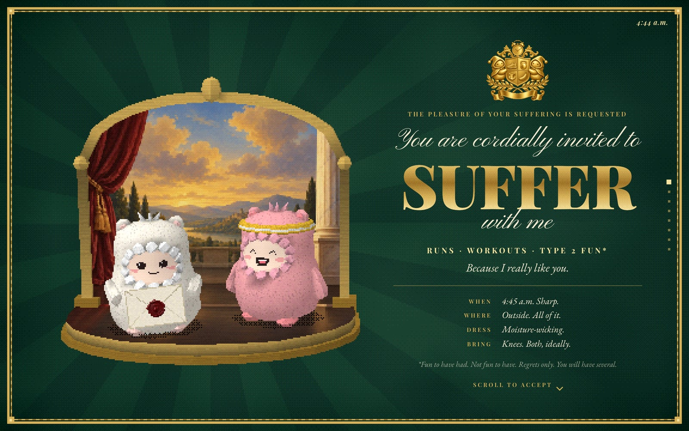
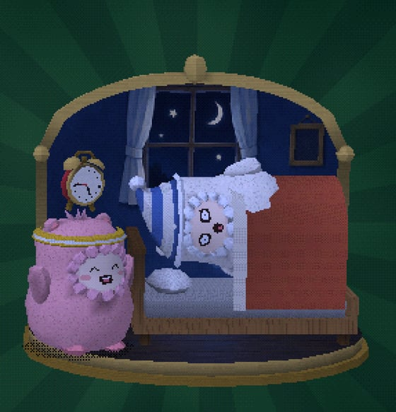
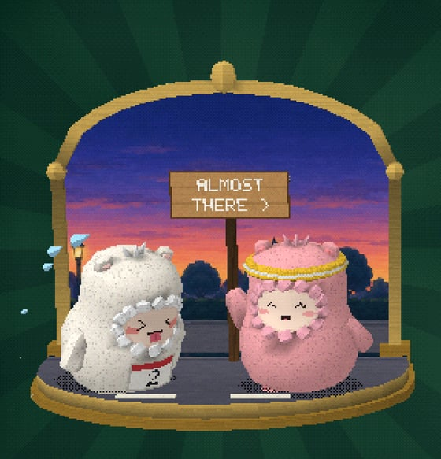
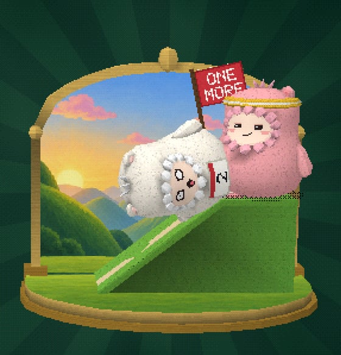
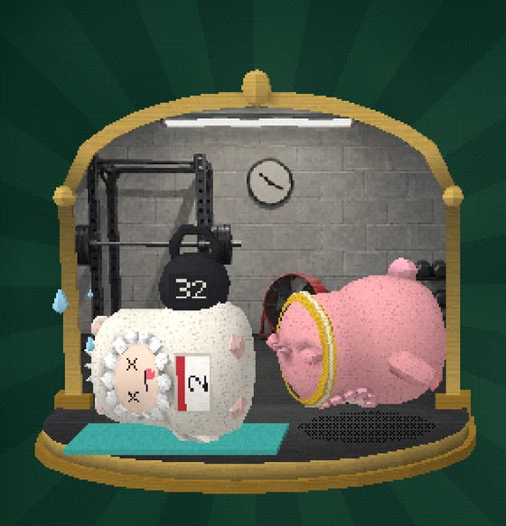
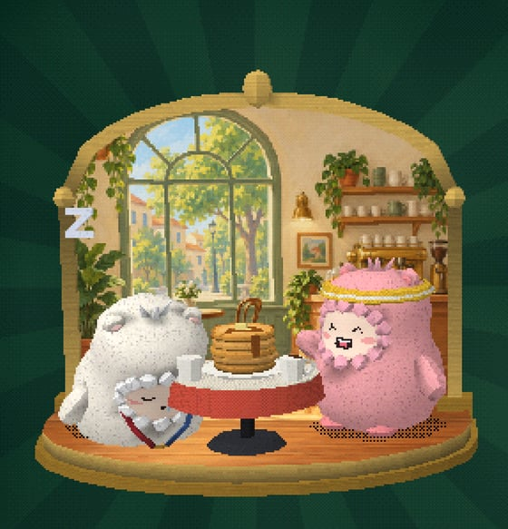
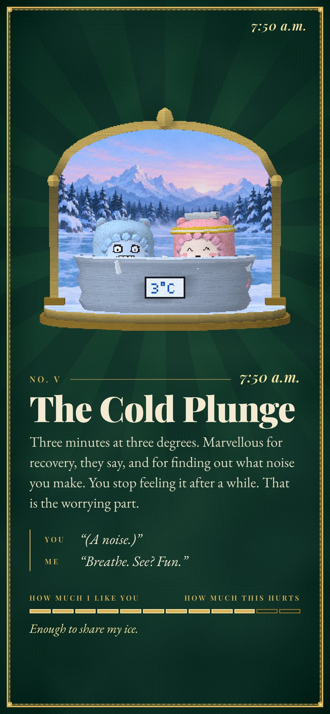
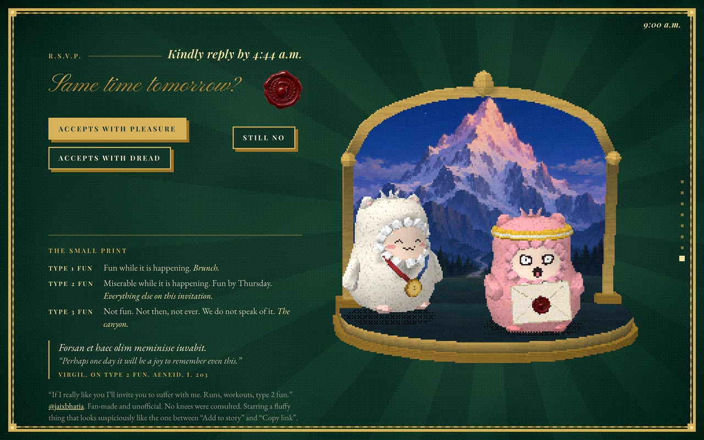
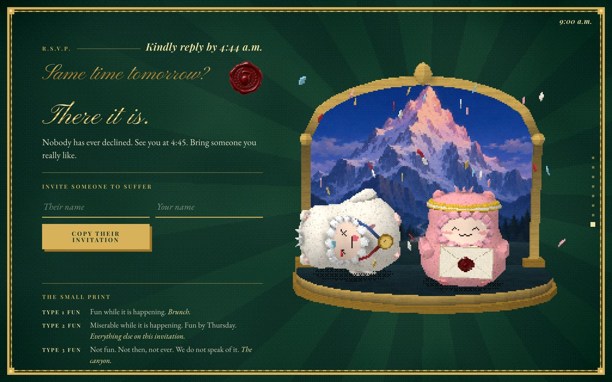

# You are cordially invited to suffer

> The pleasure of your suffering is requested. 4:45 a.m. sharp. Dress: moisture-wicking. Bring knees. Both, ideally.

[](https://davidyen1124.github.io/suffer-with-me/)

**R.S.V.P.: <https://davidyen1124.github.io/suffer-with-me/>**

## What is this?

A formal invitation, on heavy green card with gold foil, to the thing in this post:

> If I really like you I'll invite you to suffer with me.
> Runs, workouts, type 2 fun.
>
> [@jaixbhatia](https://x.com/jaixbhatia)

Scroll, and the morning happens: six items of a programme, from the alarm at 4:45 to brunch at 8:30, each
acted out in a little toy theatre by two fluffy things. One of them is the host, and is having a lovely
time. The other one is you. Then a reply card, on which it is not really possible to decline.

Every picture here is a screenshot of the page. Fan-made and unofficial. No knees were consulted.

## The programme

| No. | Time | Item | In the theatre | How much I like you |
|---|---|---|---|---|
| I | 4:45 | The Alarm | A wake-up call, delivered in person | A normal amount. |
| II | 5:15 | The "Easy" Run | Conversational pace. The same sign keeps coming round | Quite a lot, actually. |
| III | 6:20 | The Hill | Up, a hop at a time, and down the way a ball of fluff goes down a hill | An alarming amount. |
| IV | 7:05 | The Workout | One of them does burpees. The other has had a kettlebell put on it | More than is medically advisable. |
| V | 7:50 | The Cold Plunge | Three minutes at 3 °C. One is blue | Enough to share my ice. |
| VI | 8:30 | Brunch | Type 1 fun, and somebody falling asleep in it | The full amount. |

The last column is the gauge on each page. It has two labels, *how much I like you* and *how much this
hurts*, and one bar. It only goes up.

| I. The Alarm | II. The "Easy" Run | III. The Hill |
|---|---|---|
|  |  |  |

| IV. The Workout | V. The Cold Plunge | VI. Brunch |
|---|---|---|
|  |  |  |

Also on the page:

- **A crest.** A running shoe, a kettlebell, an ice cube and a banana, under an alarm clock, held up by
  two fluffy things.
- **A clock**, top right, that runs with the scroll. It says 4:44 on the cover. By the time you reach the
  reply card it says 9:00, and the card says *Kindly reply by 4:44 a.m.*
- **A dot for each page**, down the side.
- **A tab title.** Leave the tab alone and it changes to *One more?*

On a phone the theatre goes on top and the words go underneath:



## How to decline

1. Scroll to the reply card. There are three buttons: *Accepts with pleasure*, *Accepts with dread*, and
   *Declines*.
2. Go to press *Declines*. It leaves. It now says *Nice try*.
3. Follow it. *Still no.* Follow it again. *Admirable.*
4. The fourth time it stops running, turns gold, and says *Fine. Accepts.* Press it.
5. *There it is. Nobody has ever declined.*

A mouse, a finger and a keyboard all get the same treatment. Dread, the card notes, is also a yes.

| Trying to decline | Having accepted |
|---|---|
|  |  |

Each time the button gets away, somebody on the stage thinks, for a moment, that this might work.

Once you have accepted, you can write an invitation to somebody else:
`?to=Their+name&from=Yours` puts their name on the cover and yours under it.

## The small print

It is on the reply card, under the buttons.

| | What it is | For example |
|---|---|---|
| Type 1 fun | Fun while it is happening. | Brunch. |
| Type 2 fun | Miserable while it is happening. Fun by Thursday. | Everything else on this invitation. |
| Type 3 fun | Not fun. Not then, not ever. We do not speak of it. | The canyon. |

Then Virgil, who described type 2 fun in about 20 BC: *Forsan et haec olim meminisse iuvabit.* Perhaps one
day it will be a joy to remember even this. (Aeneid, I. 203)

## FAQ

**Is it really at 4:45?**
Sharp.

**Where?**
Outside. All of it.

**It doesn't work without JavaScript.**
The invitation needs JavaScript; the suffering does not.

**I have asked my computer for less motion.**
Then every theatre holds still, 3.4 seconds into its loop. Nothing else about the morning changes.

**Why does it look like that?**
See below. It is on purpose.

## What's inside

**An invitation, printed by a games console.** Everything except the type is drawn the way a mid-90s
console would draw it, in the same coarse pixels:

- the **theatres**: few polygons, 32-pixel textures with no filtering, lighting worked out per vertex,
  vertices snapped to whole pixels, textures stretched flat across each triangle (so they swim a little),
  15-bit colour with an ordered dither. A theatre is about 256 pixels across whatever the screen, and is
  scaled up with hard edges. Shadows are a checkerboard, not a grey;
- the **card** (`src/paper.js`, a small shader on its own canvas under everything): big shaded triangles,
  dithered, with rays fanning out from behind whichever theatre is on stage, and a gold border;
- the **backdrops**: paintings, shrunk to the same pixels and stood up behind the actors, the way
  pre-rendered backgrounds stood behind the low-polygon cast of a 1997 adventure game.

**The type is type.** Every word is real text in the page, set in
[Playfair Display](https://fonts.google.com/specimen/Playfair+Display),
[EB Garamond](https://fonts.google.com/specimen/EB+Garamond) and
[Pinyon Script](https://fonts.google.com/specimen/Pinyon+Script) (all open source), and is as sharp as the
screen. The largest words are filled with the console's dithered gold, clipped to the letters.

It was made with three tools, each run from a script, so all of it can be made again.

**Codex CLI's image generation paints.** `assets-src/art/manifest.mjs` holds a brief for each of the eight
backdrops (an eighteenth-century portrait with nobody sitting for it, a bedroom at a quarter to five, a
road before sunrise, far too many hills, a garage gym, a frozen lake, a cafe, one very large mountain),
for the crest and for the wax seal. `scripts/gen.mjs` runs one `codex exec` per picture, in a read-only
sandbox, and collects what its built-in `image_gen` tool made. `scripts/cook.mjs` cuts each backdrop into
the part that shows above the stage and the ground under it (which is laid on the stage floor), and
shrinks everything.

**Blender, with no window, models.** `scripts/textures.mjs` draws the pixel textures, including a sheet of
twelve faces (happy, asleep, dread, strain, dead, frozen, bliss...). `assets-src/blender/build_suffer.py`
then makes every object out of lathes, lofts and boxes (`assets-src/blender/kit.py`), bakes ambient
occlusion into the vertex colours by casting rays, and exports `public/models/suffer.glb`: 33 parts, about
4,000 triangles. It is a box of parts, not a scene. A fluffy thing is a body, a face, two arms and two
feet, each with its pivot where it turns.

**The page puts on the show.** `src/stage.js` builds a theatre for each page out of the parts and pins it to
an empty box in that page, so the layout is ordinary CSS and the 3D follows it. `src/scenes.js` is the
acting: every scene is a loop worked out from the clock, with no keyframes, so any moment of it can be
photographed (`?t=3.5` holds every loop at 3.5 seconds). One fur material is tinted cream or pink; an
expression is a move to another cell of the sheet of faces.

**The favicon and the social card** both come from `npm run meta`, which writes them into `public/`.

- **The icon** is the guest's face, drawn pixel by pixel in `scripts/meta.mjs`: sixteen pixels placed by
  hand for the smallest size, thirty-two drawn from a few ellipses for the rest. A browser tab gets it on a
  rounded tile of the card (`favicon.svg`, and a `favicon.ico` of PNGs for browsers that want one); a home
  screen gets it inside a gold rule, scaled by whole pixels (`apple-touch-icon.png`, `icon-192.png`,
  `icon-512.png`).
- **The card** (`og.jpg`, 1200 × 630) is a photograph of the page itself. `?card` lays the cover out to be
  read at the size of a thumbnail, the theatre close up and the wording large, and `scripts/meta.mjs`
  photographs that. `node scripts/card-try.mjs "zoom=1.3&x=-0.03&y=0.1"` tries another framing.

## Where things live

```
index.html            static shell; the first paint is the card, its border and a counter
src/                  the page
  main.js             boot, the type, the frame loop, the clock, the reply card
  copy.js             every word
  styles.css          type and layout
  stage.js            renderer, shader, the theatres, the fluffy things
  scenes.js           what happens in each theatre
  paper.js            the dithered card, its rays and its border; the dithered gold for the largest type
  asset.js            the address of a file in public/, wherever the page is served from
  faces.json          where each face is on the sheet (written by scripts/textures.mjs)
public/               served as it is: the cut-down paintings, the model, the icons, the social card
scripts/              painting, cutting, textures, icons, photographs
assets-src/           what the page is made from, and does not ship
  art/                the briefs, and what was painted from them
  blender/            the model's source, and its pixel textures
docs/                 the pictures in this README
```

## Run it locally

```sh
npm install
npm run dev          # http://localhost:5173
npm run build        # static site in dist/
```

Making the parts again:

```sh
npm run art          # paint whatever is missing from assets-src/art/raw (add --force and names to repaint); needs Codex CLI
npm run art:cook     # cut and shrink into public/art
npm run model        # draws the textures, then runs Blender (4 or later, at /Applications/Blender.app)
npm run meta         # favicon, app icons, social card (needs the dev server on :5190)
```

Looking at it. All with Playwright, all needing `npm run dev -- --port 5190`:

```sh
node scripts/shots.mjs mobile 3.5      # every page at one window size (desktop, laptop, wide, tablet, mobile, small)
node scripts/strip.mjs mobile 3.5      # ...side by side in one picture, in qa/
node scripts/acts.mjs desktop          # every theatre at seven moments of its loop
node scripts/try-dodge.mjs             # presses the button that would rather not be pressed
```

## Deploying

Pushing to `main` runs [a GitHub Actions workflow](.github/workflows/pages.yml) that builds with Vite and
publishes `dist/` to GitHub Pages. The build uses relative paths (`base: './'`), so it works under
`/suffer-with-me/` or anywhere else. The one exception is the social card, which has to be a whole
address: that is written out in `index.html`.

## Credits

- The post, and so the idea: [@jaixbhatia](https://x.com/jaixbhatia).
- The 3D is [three.js](https://threejs.org). The model was built in Blender, and the paintings were made
  with Codex CLI's image generation.
- Starring a fluffy thing that looks suspiciously like the one between "Add to story" and "Copy link".
- Fan-made and unofficial. No knees were consulted.
